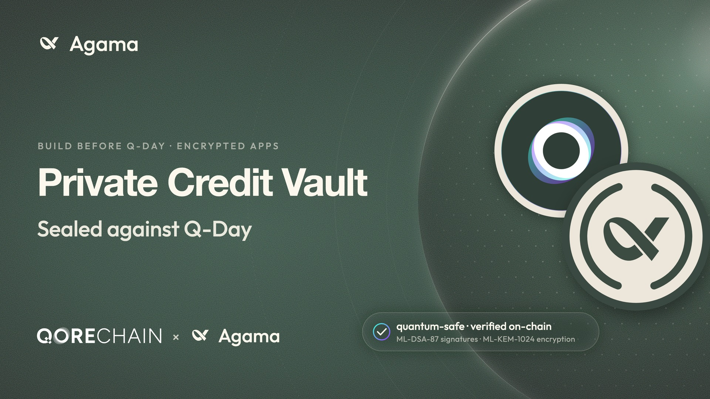
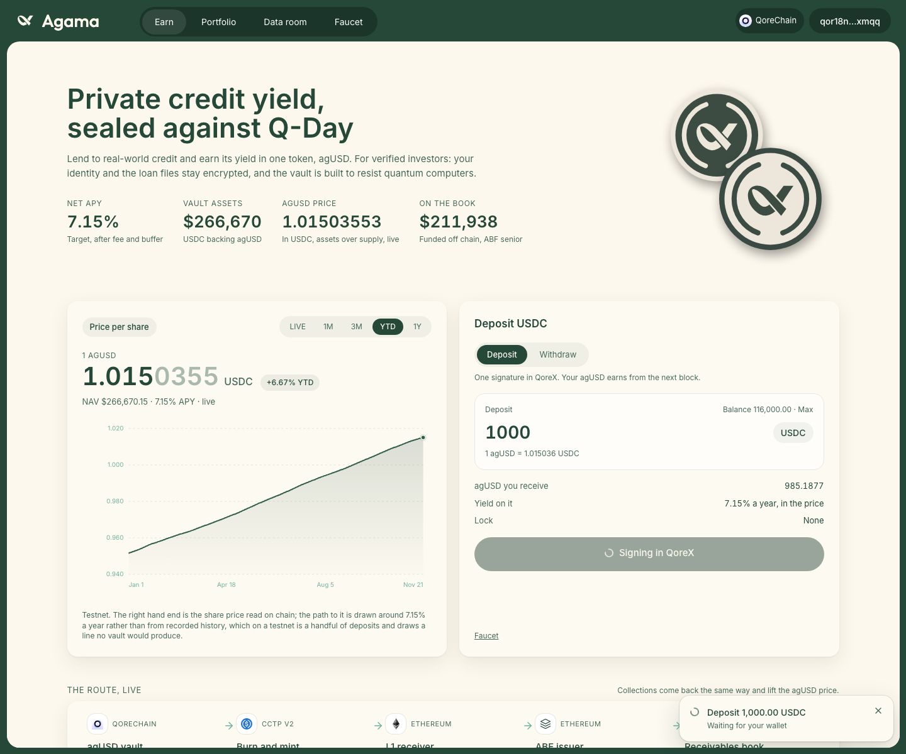
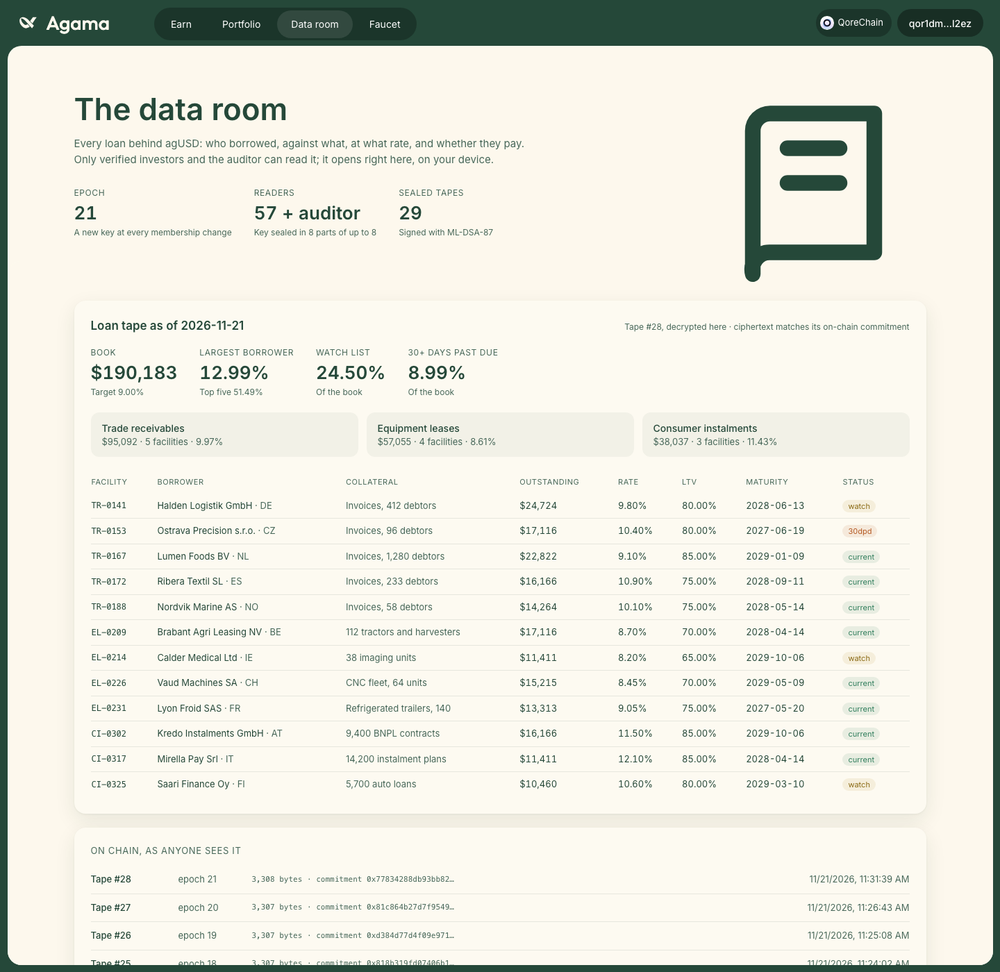

<p align="center"></p>

<p align="center">
  <a href="https://app.agama.finance/qorechain"><b>Live app</b></a> ·
  <a href="#verify-it-yourself-in-five-minutes">Verify it yourself</a> ·
  <a href="docs/ARCHITECTURE.md">Architecture</a> ·
  <a href="docs/THREAT_MODEL.md">Threat model</a> ·
  <a href="docs/battery/native-lane.md">Latest battery, with hashes</a>
</p>

<p align="center"><a href="https://build.qorechain.io/p/agama"></a></p>

# Agama on QoreChain

**A permissioned private-credit vault where every lender's identity and every loan file stay encrypted on chain, and
where no key a quantum computer could break can move the money.**

Built for **Build Before Q-Day** (QoreChain Developer Fest), track **Encrypted Apps**, on the `qorechain-diana`
testnet, during the fest. Live, with a running keeper and a bridge to Ethereum Sepolia.

## In one minute

- **Lenders deposit USDC and hold agUSD**, a permissioned ERC-4626 share; the yield of an asset-backed credit book
  lands in its price. The capital crosses to an issuer on Ethereum and comes back, **attested with ML-DSA**.
- **KYC is sealed in the browser** with ML-KEM-1024 (QoreSeal) to the compliance officer and the auditor. The chain
  stores ciphertext only. The decision is an **ML-DSA-87 signature checked on chain by `pqcVerify`**, and the decision
  letter is sealed back to the lender.
- **The loan tape lives on chain, encrypted** to the approved lenders and the auditor, with a new group key at every
  membership change. Investors see every loan; the public sees ciphertext and commitments.
- **Every lender account is a post-quantum smart account** (`PqAccount`): only the ML-DSA-87 key of the lender's QoreX
  account moves it, checked on chain. The lender signs a plain-text message in QoreX: **no gas, no EVM window, no
  setup**.
- **Nothing Agama sends on QoreChain is ECDSA-only.** The relayer and the keeper send hybrid-signed (secp256k1 +
  ML-DSA-87) native transactions; QoreChain's explorer shows every one *quantum-safe, verified on-chain*, and the chain
  **refuses** an ECDSA-only transaction from any of Agama's accounts. Measured: **584/584**.

<table>
  <tr>
    <td width="50%"></td>
    <td width="50%"></td>
  </tr>
  <tr>
    <td align="center"><sub>Earn: one QoreX signature to deposit, Agama pays the gas</sub></td>
    <td align="center"><sub>Data room: the encrypted loan tape, opened in the browser</sub></td>
  </tr>
</table>

## Why private credit needs a post-quantum, encrypted chain

Private credit is a lending market of about $1.7 trillion run on PDFs and data rooms. Putting it on chain hits three
walls. QoreChain has what it takes to solve all three together:

| The wall | Why a normal public chain fails | What Agama does on QoreChain |
|---|---|---|
| **Only verified investors may lend** | KYC on a public ledger exposes identities forever | KYC sealed with ML-KEM-1024 to two officers; an ML-DSA-87 decision checked on chain; the Asset Kit guard and an ERC-3643 module enforce it |
| **Investors must see the loans; the public must not** | Borrowers, rates and delinquencies are confidential business data | The loan tape is published on chain as a QoreSeal private batch, keyed per membership epoch; members decrypt it, everyone can verify its commitment |
| **The data and the money must outlive Q-Day** | Identities and credit files are kept 5 to 10 years: *harvest now, decrypt later*. ECDSA-signed money movements can be forged once secp256k1 falls | Every secret is ML-KEM-1024; every decision, mark, admin action, bridge attestation and transaction carries ML-DSA |

## Try it in two minutes

1. Open **[app.agama.finance/qorechain](https://app.agama.finance/qorechain)** with the
   [QoreX](https://docs.qorechain.io/qorex/browser-extension) extension on the testnet.
2. **Faucet**: get 10,000 mock USDC. One signature, no gas.
3. **Earn**: fill the short form and press *Get verified*. Your answers are sealed in the browser; the keeper's
   compliance officer decides within a minute, ML-DSA-87 signed.
4. **Deposit** USDC, receive agUSD. Then open the **Data room**: the loan tape decrypts by itself.
5. Click **View transaction** on any toast. The explorer opens on mainnet the first time: switch it to **Testnet**
   (top right) once. Every Agama transaction shows *Signature security: quantum-safe, verified on-chain, ML-DSA-87*.

## Where QoreChain's post-quantum stack is used

| Action | Protected by | Checked by |
|---|---|---|
| Every lender action (faucet, key, dossier, deposit, exit) | the lender's **ML-DSA-87** signature over a plain-text message (QoreX `signArbitrary`, hybrid with secp256k1) | its `PqAccount` on chain: `pqcVerify` (0x0a01) against the key from `pqcKeyStatus` (0x0a02), nonce and deadline bound |
| Every transaction Agama's relayer and keeper send | hybrid signature, secp256k1 + ML-DSA-87, native `MsgCrossVMCall` | the chain's ante handler (`pqc_hybrid_verify`); no EVM window exists, so ECDSA alone is refused |
| Lender's encryption key | ML-KEM-1024 key in QoreChain's **KEM registry** and the AccessRegistry | refused for accounts the Asset Kit guard does not see as hybrid holders |
| KYC dossier | QoreSeal envelope, hybrid ML-KEM-1024 + X25519, to the officers' registered keys, their QoreSign recipient cards verified | only the compliance officer and the auditor can open it |
| Where a dossier came from | the relayer's transaction (QoreSign `verifyHybridTx`) and the owner's ML-DSA-87 signature, re-verified off chain | the compliance officer, before it reads the dossier |
| Compliance decision | officer's ML-DSA-87 signature over the exact dossier hash and the letter's hash | `pqcVerify` |
| Decision letter | QoreSeal envelope to the lender and the auditor, bound to the lender's address | opened in the browser |
| Who may hold agUSD | approval, not expired, and still a hybrid holder | agUSD `_update` on every mint and transfer (burns are never gated) |
| Loan tape | QoreSeal epoch keys (sealed in parts of eight readers) and private batches, SHA3-256 commitments | members and the auditor decrypt; outsiders cannot |
| Epochs, tapes, NAV marks | manager's and reporter's ML-DSA-87 signatures | `pqcVerify`, plus interval and max-move guards on the NAV |
| Money coming home from Ethereum | attester's ML-DSA-87 signature over the CCTP message | `pqcVerify` in `PqAttestedMessenger` |
| Money going out to Ethereum | attester's secp256k1 **and** ML-DSA-44 (FIPS 204) or Merkle WOTS+ | `HybridAttestedMessenger` on Sepolia, ML-DSA-44 verified in Solidity (~8.3M gas); no owner ([docs/PQ_ETHEREUM.md](docs/PQ_ETHEREUM.md)) |
| Every admin power (config, roles, receivers, attester, officer, manager) | admin's ML-DSA-87 signature | `pqcVerify`; no function checks `msg.sender` for admin powers |
| Keeper's gas | an ed25519 **authenticator** on the treasury: `send` QOR only, 5 per payment, 15 a day | the chain's spending rule (`abstractaccount`); the treasury's keys never reach the keeper |

**Kits used:** QoreChain SDK, QoreSeal, QoreSign, qorechain-pqc, QoreX integrations (`@qorechain/qorex-types`,
`@qorechain/qorex-wallet-mock`), Asset Kit (`QoreChainHybridHolderGuard`, `IHolderEligibility`,
`IERC3643ComplianceModule`), QoreScan (CBOM, DORA mapping, crypto-agility template in [docs/cbom](docs/cbom)).

**Network functions used:** hybrid ML-DSA-87 transactions; PQC key registration with proof of possession;
`pqcVerify` and `pqcKeyStatus` from Solidity; the KEM registry (`MsgRegisterKEMKey`); cross-VM calls
(`MsgCrossVMCall`, native to EVM); EVM windows (closed, their refusal of ECDSA-only transactions tested); smart
accounts and spending rules; the fest's fUSD (`MsgConvertCoin`, `FestUsdOnRamp`).

## How it works

```
 Browser + QoreX                    QoreChain diana (EVM 9800)                         Ethereum Sepolia
 ───────────────                    ──────────────────────────                         ────────────────
 lender signs a text message ─────► relayer: native MsgCrossVMCall, hybrid-signed
 (secp256k1 + ML-DSA-87)            PqAccountFactory.execute
                                      PqAccount: pqcVerify(owner's ML-DSA-87 key) ✓
                                      then calls Agama, and only Agama:
 1 ML-KEM-1024 key, made here ────►   AccessRegistry.publishEncryptionKey  (+ KEM registry)
 2 KYC sealed to officer+auditor ─►   AccessRegistry.fileDossier           (ciphertext only)
                                    keeper (GitHub Actions), compliance officer:
                                      verifies where the dossier came from, opens it,
                                      decides, seals the letter, signs ML-DSA-87
                                    AccessRegistry.approve ─── pqcVerify ✓
 3 letter opened here ◄───────────  (sealed letter, read from the officer's call)
 4 deposit ───────────────────────►   agUSD (ERC-4626, permissioned)
                                      10% buffer stays; the rest:
                                    CrossChainAllocator ── CCTP V2 burn ─────────────►  HybridAttestedMessenger
                                                          secp256k1 + ML-DSA-44 attest  AgamaL1Receiver
                                                                                         AbfAssetIssuer → custody,
                                                                                         the ABF credit book
                                    reportNav ── ML-DSA-87, pqcVerify ✓  ◄────────────── NAV of the position
                                    settleReturn ◄── ML-DSA-87 attested ◄─────────────── collections, burned home
 5 data room: key part opened ◄───  DataRoom epoch (key sealed to members, in parts)
   loan tape decrypted here  ◄────  DataRoom report (QoreSeal private batch)
```

Two design choices the judges should know about, both forced by the real testnet and both documented:

- **PqAccounts.** QoreX 0.4.3 refuses to sign a `MsgCrossVMCall` (it cannot display one). Instead of asking lenders
  to open EVM windows, each lender gets a contract account that verifies its owner's ML-DSA-87 signature on chain.
  The relayer can delay a message, never change it ([FINDINGS 20](docs/FINDINGS.md)).
- **No EVM logs on the native lane.** A cross-VM call leaves no log `eth_getLogs` serves, so every reader (the bridge,
  the data room, the decision letters, the officer, the price history) rebuilds what it needs from the committed
  transaction and checks it against contract state. The bridge message is rebuilt byte for byte: **37/37** identical
  to the logged ones ([ARCHITECTURE](docs/ARCHITECTURE.md#native-lane-only-and-what-that-changes-for-readers),
  [FINDINGS 21](docs/FINDINGS.md)).

## Verify it yourself in five minutes

Everything below runs against the public testnets; nothing needs a key.

**On the explorer** (switch it to *Testnet* once, top right). Each of these shows *quantum-safe, verified on-chain*:

| Kind | Transaction |
|---|---|
| A lender's action through its PqAccount | [`6A0A3537…`](https://explore.qore.network/tx/6A0A353778109E68E169FB1CB1C8EB02EE8CF61173424B9B5720D6D27CB52D58) |
| A sealed KYC filing | [`2A486F2D…`](https://explore.qore.network/tx/2A486F2DF965D769F892FCEBF7DE84144CC4E8DC4A9974299030E284E470A620) |
| A compliance approval, ML-DSA-87 | [`75AE2BE0…`](https://explore.qore.network/tx/75AE2BE0E09F038B18557F3671180227569491E6549412F8F17F5D744DD3963B) |
| A sealed loan tape | [`CF34E871…`](https://explore.qore.network/tx/CF34E871BAA5B1191A55693F5C8845BA9440DE1043A9AA02E5F6F84FCDFC3F09) |
| A NAV mark, ML-DSA-87 | [`186ADE12…`](https://explore.qore.network/tx/186ADE12581793A31A9C2475473D6E15FFC65C5D7EF9751AAD5A00AEBBB22225) |
| An allocation to Ethereum | [`54E46403…`](https://explore.qore.network/tx/54E464036FC66910CF06C4345C0100E8D5B99B2FC36D7B1B792B1E93E5CCC010) |
| Money settled home, ML-DSA-87 attested | [`35BBC340…`](https://explore.qore.network/tx/35BBC340ED39291EE157B85FE6D18B2E3C0724CA20149F66784ACA1ECF1FDF77) |

**From a terminal** (read-only checks, no secrets):

```bash
git clone --recursive https://github.com/agamafinance/agama-qorechain && cd agama-qorechain
cd contracts && forge test                     # 212 tests: unit, fuzz, 6 invariants, ML-DSA vectors
FOUNDRY_PROFILE=deep forge test                # the long campaign: 50,000 inputs per fuzz test
cd ../keeper && npm install
npx tsx src/bridge-check.ts                    # 37/37 bridge messages rebuilt from calldata == their logs
(cd ../web && pnpm install && node e2e/explorer.mjs "faucet=6A0A353778109E68E169FB1CB1C8EB02EE8CF61173424B9B5720D6D27CB52D58")
```

`keeper/src/pq-audit.ts` (needs the role keys to attempt the refused transaction) lists every transaction of Agama's
accounts and checks that each one carries a hybrid signature the chain verified, that no EVM window is open, and that
the chain refuses an ECDSA-only transaction from the operator and the relayer.

## Evidence

Latest full run, against the production keeper and the deployed app ([docs/battery/native-lane.md](docs/battery/native-lane.md), with hashes):
Then a three-round campaign of every battery with fresh lenders, and a million fuzz cases:
[docs/battery/campaign-2026-11-21.md](docs/battery/campaign-2026-11-21.md).


| Suite | Result |
|---|---|
| Foundry (`contracts/test`) | **212/212**: unit, fuzz, 6 invariants, PqAccount, post-quantum verifier vectors. Deep profile: 20 fuzz tests × 50,000 inputs (1,000,000 cases) and 768,000 invariant calls, all green |
| Protocol battery: 8 lenders at once, 6 approved, 2 refused, deposits, exits, queue, revocation, bridge | **42/42**, 31 lender transactions |
| Protocol end to end, ending with the post-quantum-only checks | **30/30** |
| PqAccount battery: 4 new lenders, approved and rejected, deposits, exits | **26/26** |
| PqAccount checks: two actions, then replay, forged call, wrong key and a forged call sent straight to the contract, all refused; the lender spent no QOR | **7/7** |
| Browser, simple path, real hybrid signatures (official QoreX test double) | **7/7** |
| Browser, full path | **9/9**, four runs in a row |
| Explorer: 12 kinds of Agama transactions | **12/12** quantum-safe |
| Post-quantum audit: every transaction since the switch | **584/584** hybrid-verified; ECDSA-only refused |
| Bridge rebuilt without logs | **37/37** byte-identical |

The tests found real bugs: [22 findings](docs/FINDINGS.md), each with what was done. Among them: an invariant that
caught an underflow freezing the vault's marks, a bridge nonce collision that burned a return (repaired live, no
lender lost anything), a data room envelope that outgrew the public RPC at 36 readers, and QoreX refusing cross-VM
calls, which led to PqAccounts.

## Measured on qorechain-diana

| Operation (native lane, hybrid-signed) | Gas used |
|---|---|
| A lender's faucet through its PqAccount (ML-DSA-87 verified on chain) | ~0.68M |
| Publish an ML-KEM-1024 key through the PqAccount | ~0.9M |
| File a 3.5 kB sealed dossier through the PqAccount | ~4.0M |
| Allocation to Ethereum (vault, allocator, CCTP burn) | ~0.71M |
| Settle a return with a 4,627-byte ML-DSA-87 attestation | ~0.94M |
| Publish a 3.3 kB sealed loan tape, ML-DSA-87 signed | ~0.79M |

| Object | Size |
|---|---|
| ML-DSA-87 signature / public key | 4,627 B / 2,592 B |
| ML-KEM-1024 public key | 1,568 B |
| Sealed KYC dossier (two recipients) | ~3.6 kB |
| Epoch key part (eight readers and the auditor) | ~15 kB |

## Contracts

Solidity 0.8.28, Foundry, OpenZeppelin 5.4, QoreChain Asset Kit.

| Contract | Chain | What it does |
|---|---|---|
| `account/PqAccount`, `PqAccountFactory` | QoreChain | a lender's account, controlled only by its owner's ML-DSA-87 key; the factory owns the Asset Kit guard and exempts only accounts of owners with a proven key |
| `pqc/PqcAuth`, `PqcSigned`, `PqcGoverned` | QoreChain | ML-DSA-87 checks via the precompiles; single-use, domain-separated signed actions; an admin that is only a PQ key |
| `qore/AccessRegistry` | QoreChain | encryption keys, sealed dossiers, signed decisions; an Asset Kit `IHolderEligibility` policy |
| `qore/AgUSD` | QoreChain | the permissioned ERC-4626 vault: buffer, FIFO exit queue, vested profit, ML-DSA-87 NAV and governance |
| `qore/DataRoom` | QoreChain | membership epochs, keys in parts, sealed reports, ML-DSA-87 signed |
| `qore/CrossChainAllocator` | QoreChain | the vault's only route to the book, over CCTP V2 messages |
| `qore/AgamaComplianceModule` | QoreChain | Agama's sealed KYC as an ERC-3643 compliance module, for any permissioned token |
| `qore/FestUsdOnRamp` | QoreChain | the fest's fUSD into the vault's dollar, one to one, and back |
| `cctp/PqAttestedMessenger` | QoreChain | CCTP V2 burn-and-mint; inbound attestations are ML-DSA-87, checked by `pqcVerify` |
| `cctp/HybridAttestedMessenger` | Ethereum | the same, minting only with secp256k1 **and** a post-quantum proof; no owner |
| `cctp/pq/MlDsa44AttestationVerifier` | Ethereum | ML-DSA-44 (FIPS 204) in Solidity, on ZKNox's verifier |
| `cctp/pq/MerkleWotsAttestationVerifier` | Ethereum | Merkle WOTS+ (XMSS construction on keccak256), leaves spent once on chain |
| `l1/AgamaL1Receiver`, `l1/AbfAssetIssuer` | Ethereum | agUSD's position and the simulated ABF issuer (allowlisted ERC-4626 note) |

### Addresses

QoreChain `qorechain-diana`, EVM chain id 9800:

| Contract | Address |
|---|---|
| agUSD vault | `0x0ed07a6af9e1e78c0166a3c02133ac994268be5d` |
| AccessRegistry | `0x032492a0dc1159d781025a82a3999faf2d360441` |
| PqAccountFactory | `0x6a319a4ee0a6c1094f604cd893b5e58fdb7d8794` |
| DataRoom | `0x06b89566a2eef09c964522445ba578dc710ea815` |
| PqAttestedMessenger | `0x0afb58ce8aa5be74251e61e7b9404529d6087013` |
| CrossChainAllocator | `0x7e913de8003c0ad626fd2c44d56efea13c28fb17` |
| QoreChainHybridHolderGuard (Asset Kit) | `0xa112c61bff6439b11ea96ffc20cd121db3f0739a` |
| AgamaComplianceModule | `0xebcb8d74fb8354c55dc750a7feaeed46d123b391` |
| FestUsdOnRamp | `0x8cecfcd4ccb825d877baee30c52153bc6828b712` |
| Mock USDC | `0xa57f460cd0b27612e870963c20b9a27d11ddc608` |

Ethereum Sepolia: hybrid messenger `0x90d29f6947d7bfbb828851eabdd4b78bf416b9ae`, receiver
`0x0f66e08672786cba567729982570df9827b65d60`, ML-DSA-44 verifier `0xec11b12ad44f1cb4218015f86f5d2938fdcfeb8e`,
Merkle WOTS+ verifier `0x717c5e2974e33096a8c84b6eec1bed36669a10d4`, issuer
`0xc0f1d29f7778a663f3502afe9acb467d065d993f`, mock USDC `0x1c8669b4e26a642d83748984d19dd5149af8c42b`. Everything is
in [`deployments/`](deployments).

### Accounts

| Role | `qor1` address | Keys |
|---|---|---|
| Operator, admin, guardian | `qor1qvc7jve4se89maha3sn2cedn589dvny6kskgly` | ML-DSA-87 (registered, proof of possession); native hybrid transactions only, no EVM window |
| Relayer (pays lenders' gas) | `qor1pxv6l32qguyrv3xp0hpxehqd9mmlcdwp8c3qmg` | ML-DSA-87 (registered, proof of possession); native hybrid transactions only, no EVM window |
| Compliance officer, data room manager | `qor17q0jps4cvvg2x6xm3d2d44pev4shh4lx3x50re` | ML-DSA-87 + ML-KEM-1024 (KEM registry) |
| NAV reporter | `qor1gp6jjx2u7h6vrcv2h4rtsxp0al8h4mv37sn064` | ML-DSA-87, only signs |
| Bridge attester | `qor122d73j03vxdzvwlpvzdze30s0gejn2q8g252h7` | ML-DSA-87 towards QoreChain; secp256k1 + ML-DSA-44 (or WOTS+) towards Ethereum |
| Auditor (view key) | `qor1z0y4zrt2pkxmrgzzvh2cws5azlvf66zckvkx9w` | ML-KEM-1024 (KEM registry) |

## Repository map

```
contracts/   Solidity: vault, registry, data room, PqAccounts, CCTP V2 messengers, Ethereum leg (Foundry, 212 tests)
keeper/      TypeScript: the keeper (compliance, data room, NAV, bridge, book), the relayer, every battery and audit
  src/native.ts      hybrid-signed native transactions (writeNative), retries that never send a message twice
  src/chain.ts       readers for native calls: bridge messages rebuilt, key parts, tapes, letters
  src/provenance.ts  where a dossier came from, re-verified before the officer reads it
  src/pq-audit.ts    every transaction hybrid-verified, no window, ECDSA-only refused
web/         Next.js app (app.agama.finance/qorechain); lib/server/relay.ts is the relayer on Vercel
abi/  deployments/  docs/
```

## Honest scope

- **Testnets.** QoreChain `qorechain-diana` and Ethereum Sepolia; USDC is a mock, the ABF issuer and its loan tape are
  simulated (a realistic generated book of 12 facilities), and the keeper's role keys are testnet keys.
- **One EVM transaction remains possible: contract creation**, which a cross-VM call cannot do. Deployment only, from
  a window opened for it and closed after.
- **Two classical keys, by choice and bounded.** The guardian (secp256k1) can only pause new money and never costs a
  holder anything; the gas-tank authenticator (ed25519) can only spend 15 QOR a day of the treasury's gas. Both are
  in the [threat model](docs/THREAT_MODEL.md).
- **Ethereum cannot verify ML-DSA-87 at a sane gas cost.** The Ethereum leg uses ML-DSA-44 in Solidity (or Merkle
  WOTS+) alongside secp256k1, measured in [docs/PQ_ETHEREUM.md](docs/PQ_ETHEREUM.md).
- **The explorer opens on mainnet** for a first-time visitor; Agama links the right testnet transaction, and the
  visitor switches the explorer to Testnet once.

## Run it

```bash
git clone --recursive https://github.com/agamafinance/agama-qorechain && cd agama-qorechain
cd contracts && forge test && cd ..                  # 212 tests, mock precompiles locally
cd web && pnpm install && pnpm build && pnpm start   # http://localhost:3034/qorechain
cd ../keeper && npm install && npx tsx src/relayer.ts # the relayer, next to the app (the deployment runs it on Vercel)
```

Operating a deployment (testnet mnemonics only, never committed: `~/.config/qorechain/testnet.mnemonic` for the
roles, `~/.config/qorechain/agama-funder.mnemonic` for the funding QoreX account):

```bash
cd keeper
npx tsx src/keys.ts status                    # roles: QOR, ML-DSA-87, ML-KEM-1024, EVM window (none)
npx tsx src/keys.ts register all              # ML-DSA-87 keys with proof of possession
npx tsx src/keys.ts kem all                   # officers' ML-KEM-1024 keys in the KEM registry
npx tsx src/cards.ts                          # QoreSign-signed recipient cards
npx tsx src/keys.ts window 1200 80 unscoped && (cd ../contracts && forge build) && npx tsx src/deploy.ts
npx tsx src/keys.ts close                     # contract creation is the one EVM transaction: close the window after
npx tsx src/gastank.ts link                   # the treasury links the keeper's gas tank (spending rule)
npx tsx src/cli.ts loop 345                   # the keeper: relay, book, rebalance, NAV, queue, compliance, data room
npx tsx src/e2e.ts                            # on-chain end to end, ending with the post-quantum-only checks
npx tsx src/battery.ts                        # 8 lenders at once against the running keeper
npx tsx src/pq-battery.ts && npx tsx src/pq-check.ts   # PqAccounts: lifecycle and attacks
npx tsx src/pq-audit.ts                       # every transaction hybrid-verified, no window, ECDSA-only refused
(cd ../web && node e2e/onboarding.mjs && node e2e/browser.mjs)   # browser end to end (QoreX test double)
```

The keeper runs on GitHub Actions ([`.github/workflows/keeper.yml`](.github/workflows/keeper.yml)), the app and the
relayer on Vercel.

## Docs

- [docs/ARCHITECTURE.md](docs/ARCHITECTURE.md): contracts, keeper, app, PqAccounts, the native lane and its readers
- [docs/THREAT_MODEL.md](docs/THREAT_MODEL.md): what each key can do, what a quantum adversary can and cannot do
- [docs/PQ_ETHEREUM.md](docs/PQ_ETHEREUM.md): making the Ethereum leg quantum resilient, every option, measured
- [docs/FINDINGS.md](docs/FINDINGS.md): 22 findings from the tests and the live keeper, and what was done
- [docs/battery/native-lane.md](docs/battery/native-lane.md): the latest run of every suite, with hashes
- [docs/E2E.md](docs/E2E.md): the end-to-end runs, on chain and in the browser
- [docs/cbom](docs/cbom): QoreScan CBOM, DORA mapping, crypto-agility template
- [llms.txt](llms.txt): this project in one page, for AI agents
- [AI_USAGE.md](AI_USAGE.md)

## Credits

Written during the fest. Reused, with credit: [Agama on Whitechain](https://github.com/agamafinance/agama-whitechain)
(the vault accounting, the CCTP V2 codec, the Ethereum leg, the web app's look). QoreChain's kits:
QoreChain SDK, QoreSeal, QoreSign, qorechain-pqc, QoreX integrations, Asset Kit (Apache-2.0), QoreScan.
[ZKNox ETHDILITHIUM](https://github.com/ZKNoxHQ/ETHDILITHIUM) (MIT, the Solidity ML-DSA verifier), OpenZeppelin
Contracts 5.4, forge-std, viem, Next.js.

Licence: [Apache-2.0](LICENSE).
